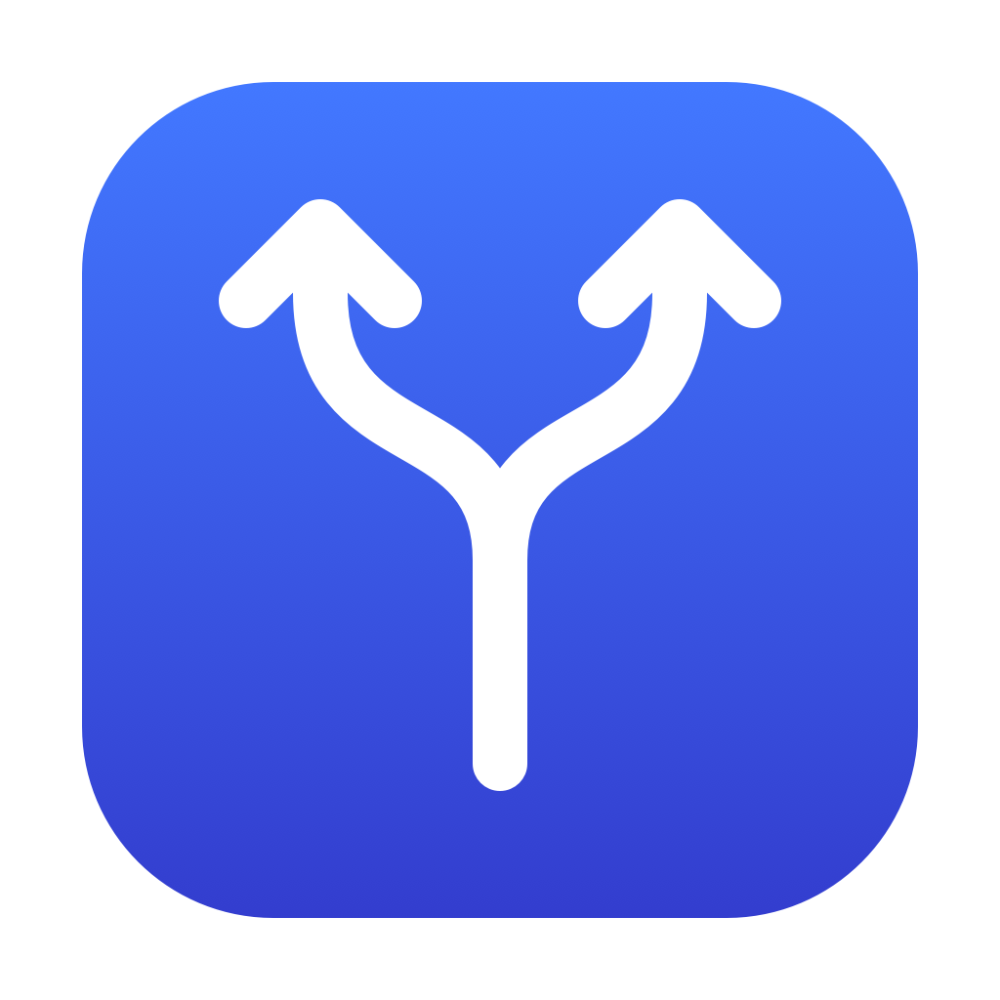
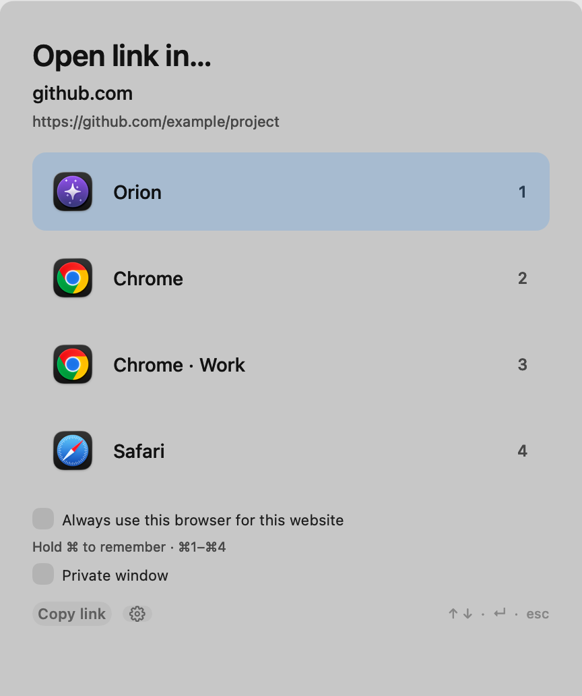
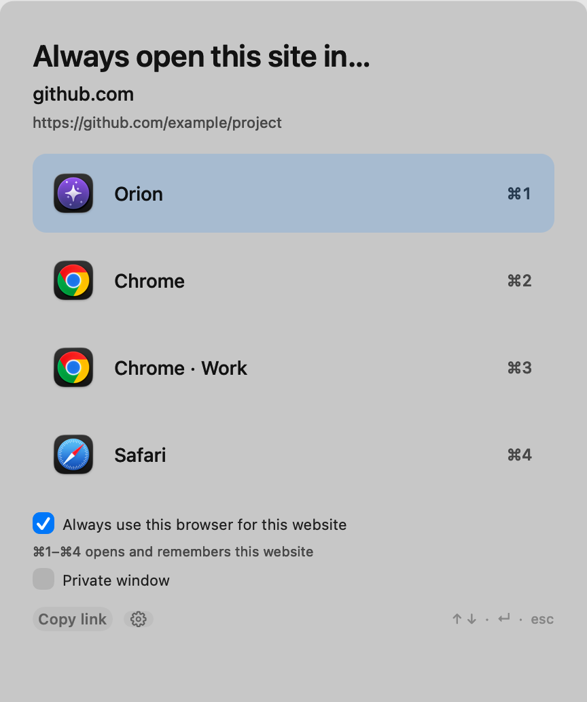
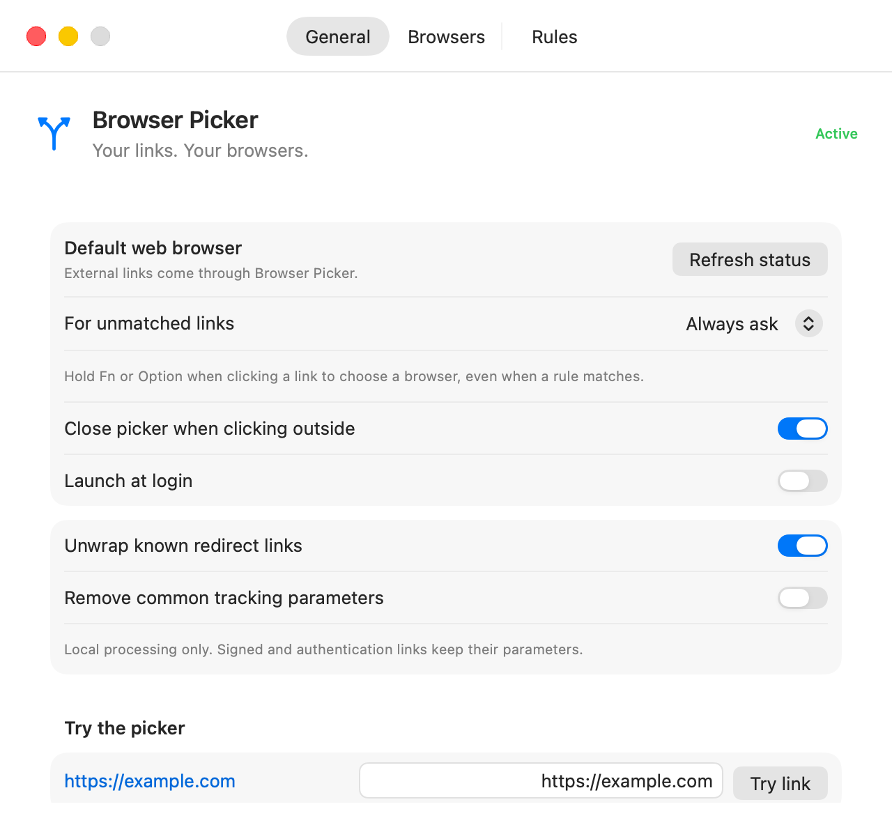
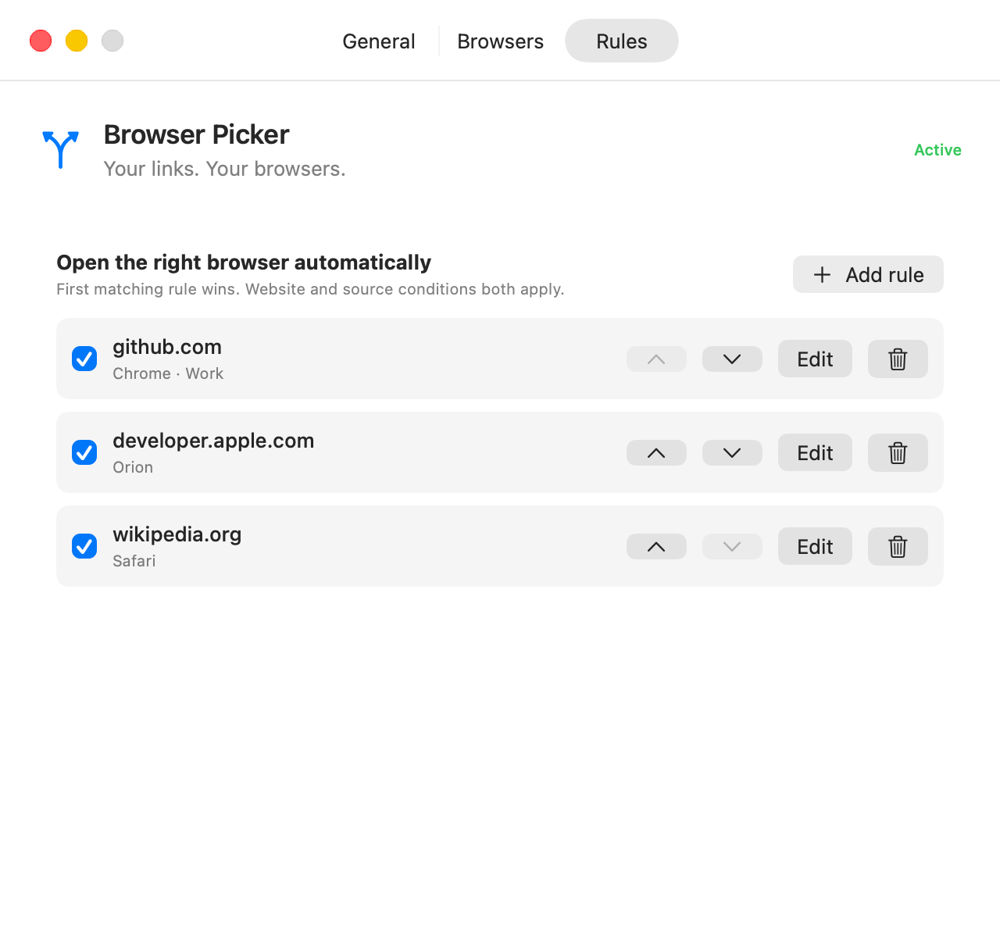

<p align="center">
  
</p>

<h1 align="center">Browser Picker</h1>
<p align="center"><strong>Every link. The right browser.</strong><br>A small, native macOS app that puts you in control of where links open.</p>
<p align="center">macOS 14+ · Swift 6 · No third-party dependencies · <a href="LICENSE">MIT license</a></p>

<p align="center">
  
  
</p>
<p align="center"><em>Open once, or hold ⌘ to remember the website. Screenshots use illustrative profiles and rules.</em></p>

Browser Picker lives in your menu bar. Set it as your default web browser, then choose any macOS browser or an available browser profile when an external link arrives. Keep **Always ask** for unmatched links, or let rules handle familiar websites automatically.

Local files work too: choose **Open With → Browser Picker**, drop a file onto the app, or send a `file://` URL. Any file type is forwarded to the browser you choose, without checking its contents or whether it exists. Your browser decides how to display it. To use Browser Picker whenever you open an HTML file, select it under Finder's **Get Info → Open with → Change All…**.

- **Choose quickly.** Click a browser, press its number, or use the arrow keys and Return.
- **Remember in one gesture.** Hold ⌘ and choose a browser. The checkbox, heading, and shortcut badges visibly change; ⌘1 opens and remembers browser 1.
- **Keep accounts separate.** Route websites to supported Chromium profiles, or match a path or the app a link came from.
- **Stay local.** No routing server, telemetry, or network requests. Known redirects are unwrapped on your Mac; tracking cleanup is optional.
- **Dismiss naturally.** Clicking outside closes the picker by default. Remaining queued links wait until you resume them.
- **Use native controls.** An AppKit picker, SwiftUI settings, and a small Swift routing core.

Visit the [project website](https://maxyurk.github.io/browser-picker/). Its static source lives in [docs/](docs/README.md) and publishes through GitHub Pages.

## Get started

### Requirements

- macOS 14 or later.
- At least one macOS web browser. Safari, Chrome, Firefox, Edge, Brave, Vivaldi, Opera, Arc, Zen, Orion, and other browsers can open regular links.

### Download and install

1. [Download Browser Picker for macOS](https://github.com/maxyurk/browser-picker/releases/latest/download/Browser-Picker.dmg). The universal app runs on Apple Silicon and Intel; no Xcode installation is needed.
2. Open the disk image and drag **Browser Picker.app** into **Applications**. Quit an existing copy before replacing it.
3. Open Browser Picker from **Applications**, then follow the setup steps below.

The release is ad-hoc signed and is **not Apple-notarized**. If macOS blocks the first launch, check the source and release, then choose **System Settings → Privacy & Security → Open Anyway**. See [Apple's first-launch instructions](https://support.apple.com/en-us/102445).

[ZIP download](https://github.com/maxyurk/browser-picker/releases/latest/download/Browser-Picker.zip) · [Release notes and checksums](https://github.com/maxyurk/browser-picker/releases/latest)

### Build from source

For a source build, install Xcode or Command Line Tools with **Swift 6 or later** (`swift --version`). The build uses your Mac's architecture and signs the app locally. Release CI builds and runs core tests on both Apple Silicon and Intel; native UI coverage is recorded in [TESTING.md](TESTING.md).

Clone the repository, then test and install:

```sh
git clone https://github.com/maxyurk/browser-picker.git
cd browser-picker
./scripts/test.sh
./scripts/install.sh
```

The installer builds the app, installs it in `~/Applications`, and opens it. It refuses to overwrite an existing installation. For a build without installing:

```sh
./scripts/build.sh release
open "build/Browser Picker.app"
```

### Set up once

1. Open **Settings → General → Make default…** and accept the macOS prompt. If needed, choose Browser Picker in **System Settings → Desktop & Dock → Default web browser**. The app verifies both HTTP and HTTPS before showing **Active**.
2. Leave **For unmatched links → Always ask**, or choose your preferred browser.
3. In **Browsers**, choose which browsers and profiles appear in the picker and menu bar. Changes take effect immediately. Use **Refresh browsers** after installing a browser or renaming a profile. If a browser is not detected, choose **Add browser…** and select its `.app`.
4. Optionally enable **Launch at login**. Approve it in Login Items if macOS requests it.

<p align="center"></p>

## Keyboard and mouse shortcuts

| Action | Shortcut |
| --- | --- |
| Open in a numbered browser | **1–9** |
| Select and open | **↑ / ↓ / Tab**, then **Return / Space** |
| Open and remember this website | **⌘1–⌘9** or **⌘-click** |
| Preview the remember action | Hold **⌘**; release to restore your manual checkbox choice |
| Open a private window in a supported browser | **Option-click**, or check **Private window** |
| Request a background open | Hold **Control** while choosing; browser behavior may vary |
| Force the picker over a rule or default | Hold **Fn / Option** when opening an external link |
| Copy the link and dismiss | **⌘C** |
| Open Settings | **⌘,** |
| Cancel the current link | **Escape**, or click outside |

You can also check **Always use this browser for this website** manually. A choice is remembered only after the browser launch succeeds, for the host and its subdomains.

Files use the same picker and configured default. Website rules and the remember option apply to web links; source-app rules can also route files. ⌘1–⌘9 still select browsers for files, without creating a website rule. **Open link from clipboard…** also accepts copied Finder files, file URLs, and absolute file paths.

Outside-click dismissal is enabled by default; change **Settings → General → Close picker when clicking outside** to disable it. Outside dismissal pauses any remaining queue. Choose **Resume N queued links…** in the menu bar, reopen the app, or send a new link to resume. Escape cancels the current link and advances the queue.

The menu bar also offers **Open link from clipboard…**.

## Rules and browsers

Rules match a website, a URL path prefix, a source application's bundle identifier, or a combination. All supplied conditions must match; the **first enabled matching rule wins**. A remembered choice moves to the top. Rules can also explicitly ask in the picker.

<p align="center"></p>

Browser detection uses macOS's registered HTTP/HTTPS handlers and HTML-viewing metadata, rather than a vendor allowlist. Common non-browser forwarding apps are filtered out. **Add browser…** supports runnable browser apps that are not registered or use unusual metadata, including apps outside `/Applications`. Added locations persist across restarts; multiple copies of the same browser produce a single destination. Browsers are listed alphabetically, with profiles grouped underneath. Long lists scroll, and arrow-key selection keeps the selected browser visible.

| Browser capability | Support |
| --- | --- |
| Regular HTTP/HTTPS links | Any macOS browser, using its normal URL handler |
| Profile selection | Compatible Chromium browsers publishing standard profile-root metadata |
| Private-window routing | Compatible Chromium browsers, marked **Private supported** in Settings |
| Other browser profiles/private windows | Uses the browser's regular handler; no private/profile command is guessed |

Chromium profile roots come from each app's `CrProductDirName` metadata, following [Chromium's documented profile locations](https://chromium.googlesource.com/chromium/src/+/HEAD/docs/user_data_dir.md). This supports compatible Chrome channels, Chromium, and other Chromium browsers that expose that metadata. Profile names and directories are read from that browser's `Local State`; bookmarks, cookies, passwords, and browsing history are never read. Profile and incognito switches are delivered even when the browser is already running. Custom user-data directories launched with command-line overrides are not automatically discovered.

An unavailable browser or profile falls back to the picker. Rules can still target browsers hidden from the picker. The number keys open the first nine destinations; arrows and scrolling reach the entire list.

## Privacy and link handling

HTTP and HTTPS links and local files are accepted. Files retain their original address, including query strings and fragments, and bypass tracking cleanup and redirect unwrapping. Web links in Google `/url`, Outlook Safe Links, and Facebook wrappers are unwrapped locally, to a maximum of five levels. Short links that require network requests are not expanded.

Tracking cleanup is **off by default**. When enabled, it removes common UTM and click attribution parameters while preserving query encoding, order, duplicates, and fragments. Recognized signed and token-bearing links retain their parameters.

Settings live in `~/Library/Application Support/BrowserPicker/settings.json`. Saves are atomic, with a backup of the previous valid configuration. Damaged files are preserved, backup recovery is supported, and newer schema versions are never downgraded.

Normal use records no link history. The optional development flag `--journal PATH` writes diagnostic URLs to that file; only use it with links you intend to log.

## Development

```sh
./scripts/test.sh
./scripts/test.sh -c release
./scripts/build.sh release
./scripts/test-file-handoffs.sh

# Native UI checks: temporary settings and simulated browser launches.
"build/Browser Picker.app/Contents/MacOS/BrowserPicker" \
  --simulate --test-settings /tmp/picker-test-settings.json \
  --journal /tmp/picker-test-events.jsonl --smoke-test
```

Native checks require a logged-in macOS desktop. Use a fresh temporary settings path for an isolated run. `--pick https://example.com` opens a link directly in the picker. `--diagnose-registration` reports Launch Services registration without changing it.

To reproduce the screenshots with neutral fixture data:

```sh
./scripts/screenshots.sh
```

This renders the real app views into `docs/assets/` and never reads your Browser Picker settings or Chrome profile metadata. It briefly shows native windows and requires Safari, Chrome, and Orion installed for their icons. [CONTRIBUTING.md](CONTRIBUTING.md) describes the source layout and useful checks.

See [TESTING.md](TESTING.md) for the verification record, measured performance, and platform coverage. The recorded suite includes **94 core tests** and **186 native smoke assertions**. Routing with 50 rules measured a median **13 µs** on the tested Apple Silicon Mac; browser startup and page loading are separate.

App versions come from stable Git tags such as `v1.0.1`. The [release workflow](.github/workflows/release.yml) can automatically bump patch, minor, or major, build a universal app, create the tag, and publish the downloads. See [RELEASING.md](RELEASING.md) for the release controls and versioning rules.

## Platform behavior

Browser Picker handles **external links**. Clicks inside a browser stay in that browser unless explicitly sent to this app. Universal links may open their associated app directly. Some source apps lose their sender identity when forwarding through Launch Services, so source-app rules depend on macOS providing it. Fn may be intercepted by keyboard settings; Option is also supported.

To stop using Browser Picker, choose another default browser in System Settings, disable Launch at login, and quit the app.

## Contributing and license

Bug reports, focused pull requests, and browser compatibility reports are welcome. Include your macOS version, browser version, steps to reproduce, and an anonymized example link. Please remove account names, private domains, tokens, and cookies from reports or screenshots.

Browser Picker's source, documentation, and original artwork are available under the [MIT license](LICENSE). Browser names and icons shown in screenshots belong to their respective owners.
